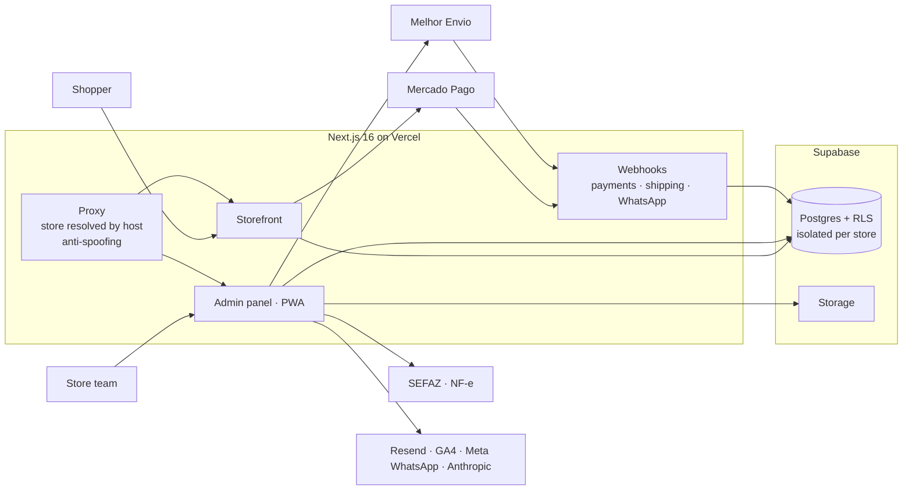

# Centtra E-commerce

**A multi-store e-commerce platform for small Brazilian brands. It covers the storefront and checkout, and also production, shipping and invoicing for made-to-order products.**

🌐 Live: [ecommerce.centtra.com.br](https://ecommerce.centtra.com.br) · 🛍️ First store in production: [leprica.com.br](https://leprica.com.br)

> **About this repository.** The platform is a commercial product, so its source code is private.
> This repository is a public showcase: it explains what the product does and how it is built, and it
> includes real modules from the codebase (with their tests) so you can judge the code itself.
> Access to the private repository can be granted during a hiring process. Just ask.

---

## The problem

Small apparel and print-on-demand brands sell made-to-order products. Generic store builders handle the checkout, but
everything after it ends up in spreadsheets and chat: approving the artwork with the customer, the production queue,
shipping labels, tracking and the electronic invoice (NF-e). This platform covers the whole flow, from the first visit
to delivery.

## What it does

| Area | Highlights |
|---|---|
| **Storefront** | Per-store branding and domain, catalog, search, cart, product personalizer, reviews ("who is already wearing it"), countdown dates, welcome pop-up, SEO and sitemap |
| **Checkout & payments** | Customer accounts, Mercado Pago (Pix and card up to 12 installments), payment confirmation by signed webhook |
| **After the sale** | Artwork proof approval by link, production queue for made-to-order items, abandoned-cart list and reminders |
| **Shipping** | Melhor Envio integration: freight quotes, labels, drop-off agencies and automatic tracking by signed webhook plus a polling fallback |
| **Fiscal** | NF-e (Brazilian electronic invoice) generation with the store's digital certificate |
| **Back office** | Orders, stock, finance, coupons, campaigns, goals, reports, GA4 visits, WhatsApp (Meta Cloud API), team roles and permissions per store, installable admin PWA |

## Architecture



### Key engineering decisions

- **Stores are tenants.** One deployment serves every store. The store is resolved from the host, and Postgres Row
  Level Security keeps each store's data apart. Dedicated tests cover header spoofing, session handling, database
  failure and preview hosts in the proxy.
- **Two paths, one decision.** Tracking updates arrive by webhook and by polling. Both feed the same pure function, so
  an order can never move differently depending on which path saw the change first
  (see [`samples/lib/frete/rastreio.ts`](samples/lib/frete/rastreio.ts)).
- **Verify everything that comes from outside.** Payment and shipping webhooks are authenticated with HMAC and
  constant-time comparison before anything is read.
- **Rules apart from I/O.** Freight quotes, delivery deadlines, installments and permissions are pure modules with
  their own tests. Server code only fetches, calls them and stores the result.
- **Disciplined migrations.** Every migration is applied to a test database first and then to production, and the
  recorded version is checked in both. The process is documented in the repository.

## In numbers

- ~1,090 automated test files (Vitest unit and integration) plus Playwright end-to-end tests
- ~320 SQL migrations

## Stack

**Frontend:** Next.js 16 (App Router), React 19, TypeScript, Tailwind CSS, Radix UI
**Backend:** Supabase (Postgres, Auth, Storage, RLS), Server Actions, Zod
**Integrations:** Mercado Pago, Melhor Envio, SEFAZ (NF-e, node-forge for certificates), Resend, Google Analytics 4, Meta WhatsApp Cloud API, Anthropic API
**Media:** sharp, pdf-lib, pdf.js, mediabunny
**Quality:** Vitest, Playwright, GitHub Actions
**Infra:** Vercel, Supabase

## Code samples in this repository

These modules were copied from the production codebase, along with their original tests.
Comments and identifiers are mostly in Portuguese, the language of the product and its users.

| File | What it shows |
|---|---|
| [`samples/lib/frete/rastreio.ts`](samples/lib/frete/rastreio.ts) | Shipment tracking: HMAC webhook verification and the single decision both webhook and polling use to move an order |
| [`samples/lib/frete/cotacao.ts`](samples/lib/frete/cotacao.ts) | Freight quote normalization and free-shipping rules |
| [`samples/lib/frete/prazos.ts`](samples/lib/frete/prazos.ts) | Delivery date = production time + carrier time, in business days and in the store's time zone |
| [`samples/lib/frete/transportadoras.ts`](samples/lib/frete/transportadoras.ts) | Carrier and drop-off agency rules |

```bash
npm install
npm test          # 65 tests
npm run typecheck
```

## Author

**Leandro Rocha** · civil engineer and software developer · Brazil
I design, build and operate the Centtra products end to end, from database and architecture to UI.

---

### 🇧🇷 Resumo em português

O **Centtra E-commerce** é uma plataforma de lojas virtuais para marcas pequenas. Ela cobre vitrine, checkout com
Mercado Pago, aprovação de arte, produção sob encomenda, frete e rastreio com Melhor Envio e emissão de NF-e. A primeira
loja em produção é a leprica.com.br. O código é privado por ser um produto comercial. Este repositório mostra a
arquitetura, as decisões técnicas e módulos reais com testes. O acesso ao repositório privado pode ser liberado durante
um processo seletivo.
